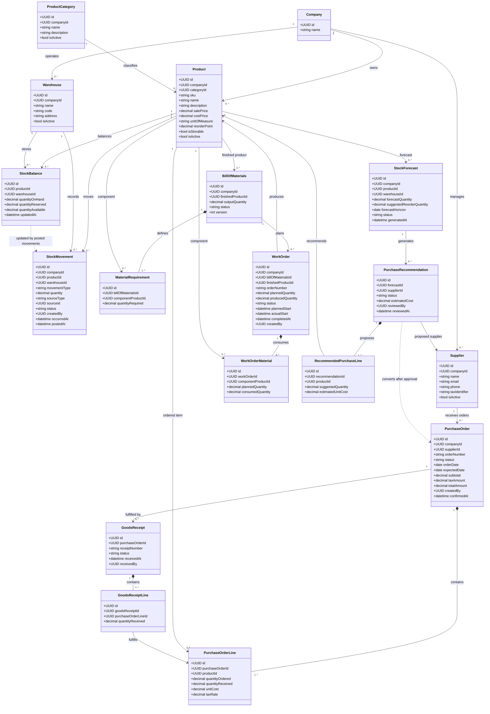
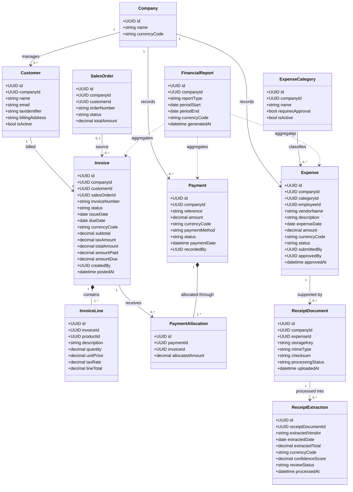
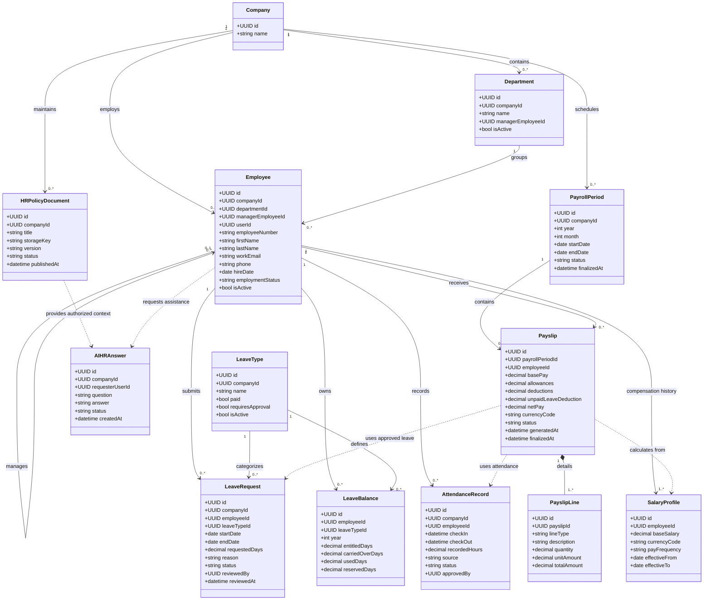
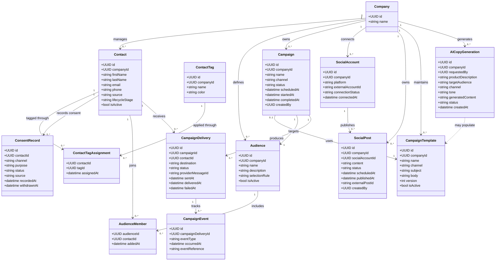
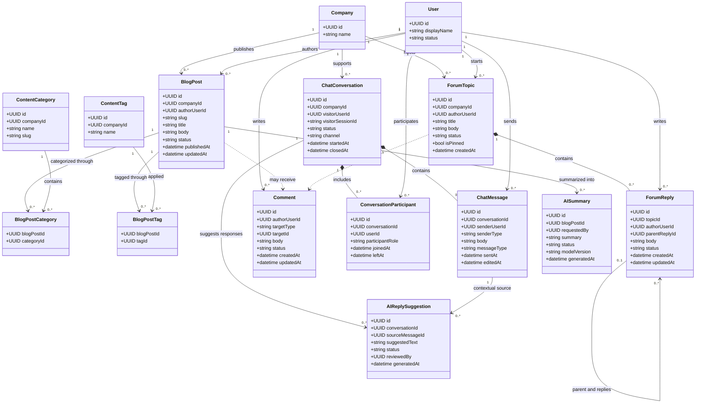

# AnOps — UML Class Diagram Architecture

Academic year: 2026/2027\
Team: Karim Feki, Nesrine Derouiche, Mohamed Abidi, Oussema Issaoui, Fatma Hidoussi

For AnOps, the right approach is to design five modular management class diagrams and one master class diagram that connects the complete platform. The diagrams should be detailed enough to guide implementation, database design, API development, permissions, and integration between modules.

The architecture takes inspiration from Odoo's modular business applications, while adapting the model to AnOps's specific scope: multi-company operations, subscription-based app access, and AI-assisted workflows.

## 1. Architecture principles

Before the diagrams, we need to distinguish four concepts that must not be mixed together:

- User account: A person who registers, signs in, or explores the public portal.
- Organization and company: The business using AnOps. One organization may eventually operate multiple companies.
- Subscription and entitlements: Determine which applications and advanced capabilities an organization can access.
- Business records: Products, invoices, employees, campaigns, articles, and other records owned by a particular company.

This distinction is essential. A user must not gain access to every application simply because they have an account, and membership in one company must not automatically grant access to another company's data.

The five diagrams below represent each student's business domain. The master diagram then connects these domains to the shared AnOps platform.

## 2. Student 1 — Karim Feki

### Inventory & Manufacturing Management

Objective: Manage the product catalog, inventory movements, suppliers, purchase orders, and manufacturing work orders. AI helps identify potential stock shortages and prepares purchase recommendations.

Diagram 1 of 6 · Inventory, Purchasing & Manufacturing

### Important implementation rules

1. Do not store stock as an independently editable product field. Stock should be derived from posted inventory movements and reconciled against stock balances. A product's reorder point is a configuration; its available quantity is an operational value.
2. `StockMovement` should distinguish draft, posted, and reversed transactions. Posted movements must not be silently edited or deleted.
3. Purchase order confirmation must not increase stock. Stock changes when goods are received and the receipt is posted.
4. Manufacturing completion must record component consumption and finished-product output consistently. These movements should be committed atomically.
5. A work order should support `Draft → In Progress → Done`, with cancellation and validation rules defined separately.
6. AI recommendations must be stored as proposals. An authorized user reviews and approves them before a real purchase order is created.
7. Quantities, prices, reservations, and receipts must be validated against company, warehouse, and product constraints.

Karim's key integration: Inventory movements feed financial reporting; purchase orders and goods receipts may be linked to supplier invoices later. Sales must eventually reserve or consume stock through the same inventory service rather than editing quantities directly.

## 3. Student 2 — Oussema Issaoui

### Finance, Invoicing & Expense Management

Objective: Generate invoices, track payments, record expenses, process receipts with OCR/AI, and provide reliable revenue and expense reports.

Diagram 2 of 6 · Finance & Invoicing

### Important implementation rules

- Invoices need a lifecycle such as `Draft → Posted → Partially Paid / Paid`, with overdue and cancelled states handled explicitly. A posted invoice should not be freely editable.
- Do not equate invoice issuance with revenue recognition or payment receipt. Reports must define whether they use invoice totals, paid amounts, or another accounting basis.
- Use `PaymentAllocation` because one payment may settle multiple invoices and one invoice may be settled by multiple payments.
- Store money with fixed-precision decimal types, currency codes, and explicit rounding rules. Never use floating-point values for monetary calculations.
- Expense approval and expense payment are separate concepts. For example, an expense may be approved but unpaid.
- Receipt OCR creates a proposed extraction. A user must be able to review and correct the vendor, date, amount, and currency before the expense is finalized.
- Keep receipt files in private object storage, use access-controlled downloads, and avoid exposing storage keys publicly.
- Reports should aggregate persisted business records using the chosen company, date range, currency, and reporting rules.

Oussema's key integration: Customer invoices can reference sales orders and products; supplier bills can later connect to Karim's purchase orders and goods receipts. Use shared product and customer references rather than creating duplicate product catalogs.

## 4. Student 3 — Mohamed Abidi

### Human Resources, Time Off & Payroll

Objective: Maintain employee profiles, handle leave requests, record attendance, generate payslips, and provide a permission-aware HR assistant.

Diagram 3 of 6 · HR & Payroll

### Important implementation rules

1. An `Employee` is a business record; a `User` is an authentication identity. Not every employee needs a login, and a user may have different access depending on company membership and role.
2. Approved leave must update the appropriate balance consistently. Avoid counting pending leave as consumed leave, although it may reserve days.
3. Prevent conflicting leave requests and invalid date ranges. Calculate working days using the applicable calendar, holidays, and leave rules.
4. Attendance records need validation, correction controls, and an audit trail.
5. Payroll must use a snapshot of the applicable salary profile, approved leave, attendance, and configured deductions for the relevant period.
6. The proposed basic payroll calculation is not a complete legal payroll engine. Tax, social contributions, overtime, statutory deductions, and Tunisian employment rules require explicit validation before production use.
7. HR AI must enforce the same access controls as the HR system. An employee should not receive another employee's salary, leave balance, or confidential records merely by asking the assistant.

Mohamed's key integration: Payroll outputs can be summarized for finance reporting. Employee access and departmental roles must be connected to the shared AnOps identity and authorization system.

## 5. Student 4 — Nesrine Derouiche

### Marketing, Campaigns & Social Management

Objective: Manage contacts and leads, design email/SMS campaigns, schedule social content, track performance, and generate marketing copy with AI.

Diagram 4 of 6 · Marketing & Campaign Management

### Important implementation rules

- Contact tags should be many-to-many. A contact can simultaneously be a lead, VIP, or inactive contact.
- Audience membership should be calculated using explicit selection rules or maintained consistently. Campaign recipients should be snapshotted when a campaign is scheduled or dispatched, according to the chosen business rules.
- Store consent by channel and purpose. Suppress recipients who have opted out or lack the required permission; enforce applicable privacy and electronic marketing rules.
- Separate campaign state from individual delivery state. A campaign can complete while some deliveries fail.
- Delivery, open, click, bounce, unsubscribe, and failure events must be deduplicated and associated with the correct delivery. Do not assume an email open is perfectly reliable.
- Scheduling and sending should be performed by background jobs with retries, idempotency, and provider error handling.
- Social publishing requires actual provider integrations and permissions. Until these exist, mark scheduling/publishing capabilities accurately and do not simulate successful external publication.
- AI-generated copy is a draft that users can review, edit, and approve before sending.

Nesrine's key integration: Marketing contacts can later connect to the CRM and sales pipeline. Campaign results should be reportable without duplicating customer or lead identities across modules.

## 6. Student 5 — Fatma Hidoussi

### Blog, Forum, Comments & Live Chat

Objective: Build a useful content and community experience with publishing workflows, discussions, comments, real-time support, and AI-assisted summarization or response suggestions.

Diagram 5 of 6 · Community & Support

### Important implementation rules

- Blog posts need draft, review, published, and archived states, with authorization for publishing.
- Forum topics and replies must support moderation, reporting, and soft deletion where appropriate.
- `Comment` uses a polymorphic target (`targetType` and `targetId`). If strict relational integrity is required, use separate `BlogComment` and `ForumComment` tables or a shared content-target design instead.
- Public visitors may be anonymous, while members can have authenticated identities. Do not force anonymous visitors to become registered members just to start a support conversation unless product policy requires it.
- Chat needs message ordering, conversation assignment, access checks, and a defined retention policy. For production real-time chat, use WebSockets or an appropriate managed service rather than relying solely on repeated polling.
- AI summaries and reply suggestions must be distinguishable from human-authored content. AI suggestions should not be sent automatically without an explicitly approved policy.
- Prevent cross-company data leakage in posts, conversations, attachments, and moderation tools.

Fatma's key integration: The public portal can expose published blog content and public discussions, while authenticated users receive additional features according to permissions. Community content must not become a backdoor into private company information.

## 7. Master class diagram — Complete AnOps platform

This is the central architecture connecting the public portal, accounts, subscriptions, organization membership, application permissions, all five student-managed domains, and AI services.

The key design decision is that a subscription grants entitlement to features, while membership and authorization determine what a particular user may do. These are separate checks.

Diagram 6 of 6 · Platform, SaaS access, business modules & AI

```mermaid
classDiagram
direction TB

%% IDENTITY AND ACCESS

class User {
  +UUID id
  +string email
  +string passwordHash
  +string fullName
  +string accountStatus
  +datetime createdAt
}

class Organization {
  +UUID id
  +string name
  +string slug
  +string status
  +datetime createdAt
}

class Company {
  +UUID id
  +UUID organizationId
  +string name
  +string currencyCode
  +string timezone
  +bool isActive
}

class Membership {
  +UUID id
  +UUID userId
  +UUID organizationId
  +string status
  +datetime joinedAt
}

class Role {
  +UUID id
  +string name
  +string description
}

class Permission {
  +UUID id
  +string resource
  +string action
}

class MembershipRole {
  +UUID membershipId
  +UUID roleId
  +UUID companyId
}

class RolePermission {
  +UUID roleId
  +UUID permissionId
}

%% APPS AND COMMERCIAL ENTITLEMENTS

class Application {
  +UUID id
  +string code
  +string name
  +string status
  +string category
}

class Plan {
  +UUID id
  +string name
  +string planType
  +string status
}

class PlanEntitlement {
  +UUID id
  +UUID planId
  +UUID applicationId
  +string accessLevel
  +string limitsConfig
}

class Subscription {
  +UUID id
  +UUID organizationId
  +UUID planId
  +string status
  +datetime startsAt
  +datetime endsAt
}

class SubscriptionApp {
  +UUID id
  +UUID subscriptionId
  +UUID applicationId
  +string status
}

class BillingRecord {
  +UUID id
  +UUID subscriptionId
  +string reference
  +decimal amount
  +string currencyCode
  +string status
  +datetime issuedAt
}

%% INVENTORY AND MANUFACTURING

class Product {
  +UUID id
  +UUID companyId
  +string sku
  +string name
  +decimal salePrice
  +decimal reorderPoint
}

class StockMovement {
  +UUID id
  +UUID companyId
  +UUID productId
  +decimal quantity
  +string movementType
  +string status
}

class Supplier {
  +UUID id
  +UUID companyId
  +string name
}

class PurchaseOrder {
  +UUID id
  +UUID companyId
  +UUID supplierId
  +string status
  +decimal totalAmount
}

class WorkOrder {
  +UUID id
  +UUID companyId
  +UUID productId
  +string status
  +decimal plannedQuantity
}

%% FINANCE

class Customer {
  +UUID id
  +UUID companyId
  +string name
  +string email
}

class Invoice {
  +UUID id
  +UUID companyId
  +UUID customerId
  +string status
  +decimal totalAmount
  +decimal amountDue
}

class Payment {
  +UUID id
  +UUID companyId
  +decimal amount
  +string status
}

class Expense {
  +UUID id
  +UUID companyId
  +decimal amount
  +string status
  +string vendorName
}

%% HUMAN RESOURCES

class Employee {
  +UUID id
  +UUID companyId
  +UUID userId
  +string employeeNumber
  +string employmentStatus
}

class LeaveRequest {
  +UUID id
  +UUID employeeId
  +string status
  +date startDate
  +date endDate
}

class AttendanceRecord {
  +UUID id
  +UUID employeeId
  +datetime checkIn
  +datetime checkOut
}

class Payslip {
  +UUID id
  +UUID employeeId
  +decimal netPay
  +string status
}

%% MARKETING

class Contact {
  +UUID id
  +UUID companyId
  +string email
  +string lifecycleStage
}

class Campaign {
  +UUID id
  +UUID companyId
  +string channel
  +string status
}

class CampaignDelivery {
  +UUID id
  +UUID campaignId
  +UUID contactId
  +string status
}

class SocialPost {
  +UUID id
  +UUID companyId
  +string status
  +datetime scheduledAt
}

%% COMMUNITY AND SUPPORT

class BlogPost {
  +UUID id
  +UUID companyId
  +UUID authorUserId
  +string title
  +string status
}

class ForumTopic {
  +UUID id
  +UUID companyId
  +UUID authorUserId
  +string title
  +string status
}

class ChatConversation {
  +UUID id
  +UUID companyId
  +string status
}

class ChatMessage {
  +UUID id
  +UUID conversationId
  +UUID senderUserId
  +string body
}

%% AI AND AUDIT

class AIJob {
  +UUID id
  +UUID organizationId
  +UUID companyId
  +UUID requestedBy
  +string featureCode
  +string status
  +string modelVersion
  +datetime createdAt
}

class AIUsageRecord {
  +UUID id
  +UUID organizationId
  +UUID aiJobId
  +string featureCode
  +decimal usageAmount
  +datetime recordedAt
}

class AuditEvent {
  +UUID id
  +UUID organizationId
  +UUID companyId
  +UUID actorUserId
  +string action
  +string entityType
  +UUID entityId
  +datetime occurredAt
}

%% IDENTITY RELATIONSHIPS

User "1" --> "0..*" Membership : joins
Organization "1" *-- "1..*" Company : contains
Organization "1" --> "0..*" Membership : grants membership
Membership "1" --> "1..*" MembershipRole : receives roles
Role "1" --> "0..*" MembershipRole : assigned through
Role "1" --> "0..*" RolePermission : contains
Permission "1" --> "0..*" RolePermission : granted through
Company "0..1" --> "0..*" MembershipRole : scopes role

%% SUBSCRIPTIONS AND APPS

Plan "1" --> "0..*" PlanEntitlement : defines
Application "1" --> "0..*" PlanEntitlement : included in plans
Organization "1" --> "0..*" Subscription : subscribes
Plan "1" --> "0..*" Subscription : selected plan
Subscription "1" --> "0..*" SubscriptionApp : activates apps
Application "1" --> "0..*" SubscriptionApp : activated through
Subscription "1" --> "0..*" BillingRecord : billed through

%% INVENTORY RELATIONSHIPS

Company "1" --> "0..*" Product : owns
Product "1" --> "0..*" StockMovement : moved through
Company "1" --> "0..*" StockMovement : records
Company "1" --> "0..*" Supplier : manages
Supplier "1" --> "0..*" PurchaseOrder : supplies
Company "1" --> "0..*" PurchaseOrder : owns
Company "1" --> "0..*" WorkOrder : owns
Product "1" --> "0..*" WorkOrder : produced

%% FINANCE RELATIONSHIPS

Company "1" --> "0..*" Customer : manages
Customer "1" --> "0..*" Invoice : receives
Company "1" --> "0..*" Invoice : issues
Company "1" --> "0..*" Payment : records
Company "1" --> "0..*" Expense : tracks
Invoice "0..*" --> "0..*" Payment : settled by allocations

%% HR RELATIONSHIPS

Company "1" --> "0..*" Employee : employs
User "0..1" --> "0..1" Employee : linked identity
Employee "1" --> "0..*" LeaveRequest : requests
Employee "1" --> "0..*" AttendanceRecord : logs
Employee "1" --> "0..*" Payslip : receives

%% MARKETING RELATIONSHIPS

Company "1" --> "0..*" Contact : manages
Company "1" --> "0..*" Campaign : owns
Campaign "1" --> "0..*" CampaignDelivery : dispatches
Contact "1" --> "0..*" CampaignDelivery : receives
Company "1" --> "0..*" SocialPost : schedules

%% COMMUNITY RELATIONSHIPS

User "1" --> "0..*" BlogPost : authors
User "1" --> "0..*" ForumTopic : starts
Company "1" --> "0..*" BlogPost : publishes
Company "1" --> "0..*" ForumTopic : hosts
Company "1" --> "0..*" ChatConversation : supports
ChatConversation "1" *-- "0..*" ChatMessage : contains

%% AI, USAGE AND AUDIT

Organization "1" --> "0..*" AIJob : requests
AIJob "1" --> "0..*" AIUsageRecord : records usage
User "1" --> "0..*" AIJob : requests
Company "0..1" --> "0..*" AIJob : contextual company
Organization "1" --> "0..*" AuditEvent : audits
User "1" --> "0..*" AuditEvent : performs actions
```

### How the complete user journey works

1\. Visitor — Public portal

Explores the homepage, application catalog, industries, community, and pricing without needing an account. No private business data is accessible.

2\. Registered user

Creates a User account and authenticates. Registration alone does not grant membership in a business organization or access to paid applications.

3\. Organization member — One App Free

Joins or creates an Organization, obtains a Membership and appropriate Role, and receives access to one eligible application under the organization's active subscription.

4\. Standard — All Apps

An organization subscribes to Standard. Its plan entitlements activate eligible applications, while each member's roles and permissions still determine which records and operations they can access.

5\. Custom — Multi-Company & Advanced AI

The organization receives the multi-company and AI entitlements included in its agreed Custom plan. Access is scoped by company, role, feature entitlement, and any applicable usage limits.

Important: Subscription ownership belongs to the organization, not independently to each employee. Company-level access and organization-level app entitlements must be enforced by the backend, not just by hiding UI elements.

## 8. Production-readiness decisions before implementation

The diagrams provide a strong starting point, but the following rules are necessary to make the implementation reliable rather than merely visually correct.

| Concern              | Required decision                                                                                                     |
| -------------------- | --------------------------------------------------------------------------------------------------------------------- |
| Multi-tenancy        | Every business record must be scoped to the correct organization/company; enforce this server-side.                   |
| Authentication       | Use the existing authentication system. Store password hashes only if password authentication is implemented locally. |
| Authorization        | Check membership, company scope, role permissions, application entitlement, and AI entitlement on the server.         |
| Subscription changes | Define what happens when a plan expires, payment fails, or an application is removed.                                 |
| Inventory            | Use transactional stock movements, receipt validation, reservation rules, and audit trails.                           |
| Finance              | Use decimal money types, payment allocations, explicit currency handling, and immutable posted records.               |
| HR                   | Restrict salary, payslip, attendance, and leave data to authorized users.                                             |
| Marketing            | Enforce consent, unsubscribe, delivery tracking, and background processing.                                           |
| AI                   | Track status, failures, usage, permissions, and human approval of consequential actions.                              |
| Community            | Add moderation, spam protection, access control, and data-retention rules.                                            |

### Recommended modeling improvements

Before creating database migrations, also decide on the following:

- Use enumerations or validated state machines for statuses such as invoice, purchase order, work order, subscription, and AI job.
- Use explicit join entities for many-to-many relationships that carry data. For example, invoice-payment allocation must have an amount and audit information; it should not remain a bare many-to-many association in the implementation.
- Use database constraints and transactions to protect invariants, not only frontend validation.
- Use an outbox or reliable job-processing mechanism for workflows that span modules, such as posting a goods receipt, sending a campaign, or generating AI results.
- Keep the AI provider replaceable. The domain model should not depend directly on a particular LLM provider.
- Define module ownership and interfaces. Karim's inventory service should own stock changes; Oussema's finance service should own invoices and payments; the other modules should interact through explicit application services or well-defined APIs.

## 9. Recommended implementation order

1. Shared foundation: User, Organization, Company, Membership, Role, Permission, Application, Plan, Entitlement, Subscription, and audit infrastructure.
2. Core operational modules: Product catalog, inventory movements, purchasing, invoices, expenses, employees, and leave requests.
3. Connected workflows: Manufacturing, payment allocation, payroll, marketing campaigns, and shared customer/contact records.
4. AI capabilities: Stock recommendations, receipt extraction, HR assistance, marketing copy generation, and content summarization/chat support.
5. Commercial readiness: Plan enforcement, billing integration, multi-company authorization, monitoring, backup/recovery, security testing, and deployment.

This sequence establishes the common platform before the individual modules depend on it. It also reduces the risk of each student independently creating incompatible versions of shared concepts such as Company, User, Product, or Customer.

Final recommendation: Treat the five diagrams as the detailed domain designs and the master diagram as the platform integration overview. Before implementing entities, review the associations as a team and agree on shared identifiers, ownership, status transitions, and API contracts. This will make the AnOps modules easier to integrate into one coherent product.